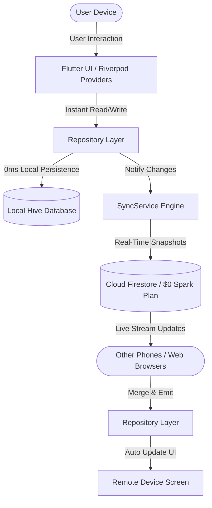

# 📝 My Notes

A modern, offline-first notes, task manager, mind-mapping, and AES-256 encrypted password vault app with real-time Google Cloud Firestore synchronization. Built with **Flutter**, **Riverpod**, **Hive**, **Firebase Authentication**, and **Cloud Firestore**.

---

## 🌟 Highlights & Features

### 🎨 Design & Visual Identity
- **Pitch-Black Dark Mode**: Designed for OLED displays with deep black (`#000000`), dark charcoal cards (`#202020`), and signature warm golden amber accents (`#F5A623`).
- **Masonry Staggered Grid**: Two-column dynamic card layout for notes of varying lengths.
- **Custom Branding & Icons**: Custom warm amber squircle & stylus favicon for web browsers and native adaptive launcher icons for Android.

### ⚡ Offline-First with Real-Time Cloud Sync
- **Hive Local Storage**: Instant 0ms reads and writes. The app functions completely offline without internet connection.
- **Cloud Firestore Real-Time Synchronization**: Live Firestore listeners automatically sync changes between multiple phones and web in real-time.
- **Pull-to-Refresh**: Native swipe-down gesture to trigger on-demand sync anytime.
- **Detailed Sync Status Indicator**: Ambient status dot (Green for synced, Amber for syncing, Red for offline) with diagnostic messages in Settings.
- **Automatic Guest Migration**: Notes written offline or before logging in automatically migrate to your Google account upon sign-in.

### 📝 Diverse Note Formats
- **Text Notes**: Rich text hierarchy, amber cursor, word/character count indicators, and category management.
- **Interactive Checklists**: Todo lists with custom rounded check indicators and strikethrough styling.
- **Drawing & Sketching**: Fullscreen sketch canvas with brush colors, adjustable stroke widths, and undo support.
- **Interactive Mind Maps**: Visual hierarchical tree editor on an infinite pan & zoom canvas with custom bezier links.
- **Image Attachments**: Gallery and camera photo attachments.

### 🔒 Password Vault (Hardware-Grade AES-256)
- **Zero-Knowledge Architecture**: Sensitive credentials never touch the cloud in plaintext.
- **Double Salted Key Stretching**: Master 4-digit PIN combined with a 16-byte cryptographic salt and iterated SHA-256 hashing.
- **AES-256-CBC Encryption**: Passwords encrypted with unique initialization vectors (IVs).

### ✅ Tasks Mode
- Dedicated tasks screen with circular completion toggles, due date pickers, priority markers, and collapsible completed tasks section.

---

## 🏗 Architecture & Data Flow



### Layer Responsibilities
- **Presentation Layer (`lib/features/`)**: Watches Riverpod providers and reactive streams. Never accesses Firebase directly.
- **Repository Layer (`lib/repositories/`)**: Manages business logic and updates local storage first for instant feedback.
- **Service Layer (`lib/services/`)**:
  - `auth_service.dart`: Handles Google Credential Manager and Firebase Authentication state.
  - `sync_service.dart`: Bidirectional sync engine managing real-time snapshot streams and offline queue flushing.
  - `firestore_service.dart`: Cloud Firestore queries and batch operations.
  - `local_storage_service.dart`: Hive boxes for notes, tasks, vault items, and settings.

---

## 📂 Project Structure

```text
lib/
├── app/
│   ├── app.dart                   # Root MaterialApp configuration
│   ├── providers.dart             # Riverpod dependency injection & streams
│   └── router.dart                # GoRouter routing & auth guards
├── core/
│   ├── theme/                     # AppColors & AppTypography
│   ├── utils/                     # AES-256 Crypto & Date formatters
│   └── widgets/                   # Common UI widgets (EmptyStateView, Icons)
├── features/
│   ├── auth/presentation/         # LoginScreen & Google Sign-In
│   ├── editor/presentation/       # NoteEditorScreen (Text, Checklist, Drawing)
│   ├── mind_map/presentation/     # Interactive node tree canvas
│   ├── notes/presentation/        # HomeScreen & note cards grid
│   ├── settings/presentation/     # SettingsScreen & manual sync controls
│   ├── tasks/presentation/        # Dedicated Tasks tab
│   └── vault/presentation/        # Master PIN entry & encrypted credentials
├── models/                        # NoteModel, TaskModel, VaultItemModel
├── repositories/                  # NotesRepository, TasksRepository, VaultRepository
└── services/                      # AuthService, FirebaseService, FirestoreService, LocalStorageService, SyncService
```

---

## 🔒 Firestore Security Rules (`firestore.rules`)

User documents are partitioned by their unique Firebase UID (`request.auth.uid`) to ensure strict multi-tenant isolation:

```javascript
rules_version = '2';
service cloud.firestore {
  match /databases/{database}/documents {
    
    function isAuthenticated() {
      return request.auth != null;
    }
    
    function isOwner(userId) {
      return isAuthenticated() && request.auth.uid == userId;
    }

    match /users/{userId} {
      allow read, write: if isOwner(userId);
      
      match /notes/{noteId} {
        allow read, write: if isOwner(userId);
      }
      match /tasks/{taskId} {
        allow read, write: if isOwner(userId);
      }
      match /vault/{vaultId} {
        allow read, write: if isOwner(userId);
      }
    }
    
    match /{document=**} {
      allow read, write: if false;
    }
  }
}
```

---

## 🚀 Getting Started

### Prerequisites
- **Flutter SDK**: `^3.29.0`
- **Dart SDK**: `^3.7.0`
- **Android SDK** (for Android APK) / **Google Chrome** (for Web)

### 1. Install Dependencies
```powershell
flutter pub get
```

### 2. Run Locally in Browser
```powershell
flutter run -d chrome
```

### 3. Run on Connected Android Phone
```powershell
flutter run -d android
```

### 4. Build Release APKs
- **Compact ARM64 APK** (19.4 MB — recommended for modern Android phones):
  ```powershell
  flutter build apk --split-per-abi --release
  # Output: build/app/outputs/flutter-apk/app-arm64-v8a-release.apk
  ```
- **Universal Release APK** (51.8 MB — all CPU architectures):
  ```powershell
  flutter build apk --release
  # Output: build/app/outputs/flutter-apk/app-release.apk
  ```

### 5. Run Tests & Linter
```powershell
# Run unit tests
flutter test

# Run static analysis
flutter analyze
```

---

## 📊 Viewing Active Users & Database

With the integrated Firebase setup, you can monitor user adoption directly:

1. **User Sign-Ins**: Open [Firebase Console](https://console.firebase.google.com/) → **Authentication** → **Users** to see registered emails, UIDs, and timestamps.
2. **Cloud Database Records**: Open **Firestore Database** → **Data** to view synced collections under `users/{uid}/notes`.
3. **Usage Costs**: Operates 100% within the free **Firebase Spark Plan** ($0/month).

---

## 📄 License
This project is open-source under the MIT License.
